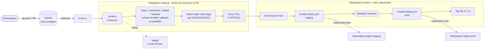

# Rapport – Chaîne CI/CD « du commit à la production »

**Projet :** Legeni WebApp (Flask + Redis) – LEGENI CONSULTING
**Auteur :** guerar25 – **Dépôt :** `github.com/guerar25/legeni-webapp`
**Outils :** Git/GitHub, Docker, Jenkins, Ansible, Kubernetes (Minikube)

> Les emplacements `📸 Capture` indiquent où insérer les captures d'écran (dossier `docs/captures/`).

---

## 1. Objectif et résultat

Avant ce projet, l'application était construite sur le poste d'un développeur puis copiée à la main sur le serveur. Désormais, **un `git push` suffit** : le code est testé, analysé, empaqueté, publié sur Docker Hub, déployé en *staging* puis, après une validation humaine, en *production*, sans interruption de service et avec retour arrière automatique en cas de problème.

Les trois scénarios imposés pour la soutenance ont été joués avec succès :

| Scénario | Résultat mesuré |
|---|---|
| 1. Livraison nominale (VERSION 1.1.0, nouvelle couleur) | PR verte sans déploiement → merge → staging → validation → prod. **2 854 requêtes pendant la mise à jour de la prod, 2 854 réponses HTTP 200, 0 erreur.** Tag `v1.1.0` créé automatiquement. |
| 2. Code défectueux (test qui échoue) | Pipeline rouge à l'étape tests (`1 failed, 6 passed`), **aucune image construite**, production inchangée (`1.0.0-15`), e-mail d'échec reçu. |
| 3. Déploiement raté (`readinessProbe` sur un mauvais chemin) | Les pods `1.1.0-19` ne deviennent jamais prêts → **rollback automatique** par Ansible, pipeline rouge, prod jamais touchée. **712 requêtes sur le staging pendant l'incident, 712 réponses 200** (servies par `1.1.0-18`). |

---

## 2. Architecture



**Infrastructure retenue : option A (une seule machine)** – WSL2 Ubuntu 24.04 sur le poste personnel, qui porte Jenkins (conteneur) et Minikube (driver docker, 2 CPU, 3 Go). Jenkins est relié au réseau Docker `minikube` avec une **IP fixe (192.168.49.100)** et joint l'API Kubernetes sur `https://192.168.49.2:8443`.

| Composant | Où | Accès |
|---|---|---|
| Jenkins | conteneur `jenkins` (image `legeni/jenkins:lts` : Docker CLI, kubectl, Ansible 2.17, plugins) | `:8080` |
| Mailpit (SMTP de test) | conteneur `mailpit`, réseau `jenkins` | boîte web `:8025` |
| Relais webhook | conteneur `smee` (smee-client 1.2.5) | — |
| Cluster | Minikube 1.39, Kubernetes 1.37, addons `metrics-server`, `ingress` | nœud `192.168.49.2` |
| Staging | namespace `legeni-staging`, 2 réplicas, bannière jaune | NodePort `30081`, `staging.legeni.local` |
| Production | namespace `legeni-prod`, 3 à 6 réplicas (HPA), bannière bleue | NodePort `30082`, `legeni.local` |

📸 *Capture : `kubectl get all -n legeni-prod` et `-n legeni-staging`*

---

## 3. Organisation du dépôt et Git (lot 0)

```
legeni-webapp/
├── app.py, tests/, requirements*.txt
├── Dockerfile, .dockerignore, VERSION
├── Jenkinsfile
├── scripts/acces-navigateur.sh       # accès navigateur Windows (port-forward)
├── ansible/
│   ├── ansible.cfg, inventory.ini, group_vars/ci.yml
│   ├── provision.yml                 # lot 2
│   ├── deploy.yml                    # lot 3
│   ├── roles/{docker,minikube,jenkins}/
│   ├── templates/k8s/app.yml.j2      # manifests Kubernetes (Jinja2)
│   └── vars/{staging,prod}.yml, vars/vault.yml (chiffré)
└── docs/rapport.md
```

- **Branche `main` protégée** : merge uniquement par *pull request*, check Jenkins `continuous-integration/jenkins/pr-merge` **obligatoire**. Le bouton *Merge* reste grisé tant que Jenkins n'est pas vert.
- **Une branche par fonctionnalité** : `feature/lot1-docker`, `feature/lot2-provision`, `feature/lot3-deploy-k8s`, `feature/lot4-5-pipeline`, `feature/notification-mail`, `feature/couleur-1.1.0`, `feature/scenario3-readiness`, `feature/webhook-smee`, `fix/...`.
- **Tags de mise en production** créés par le pipeline : `v1.0.0`, `v1.1.0` (une seule fois par version).

📸 *Captures : règle de protection de `main` ; PR avec le check « Required » ; onglet Tags*

---

## 4. Conteneurisation (lot 1)

`Dockerfile` **multi-stage** :

| Étape | Rôle |
|---|---|
| `base` | `python:3.12-slim` + dépendances (`requirements.txt` copié seul pour profiter du cache) |
| `test` | ajoute flake8/pytest et lance `flake8 . && pytest` (`docker build --target test`) |
| `runtime` | image finale minimale : utilisateur **non-root** `appuser` (uid 10001), `HEALTHCHECK` sur `/health`, `CMD` **en forme exec** (`gunicorn` reçoit directement SIGTERM → arrêt propre) |

- Version injectée par `--build-arg APP_VERSION=<VERSION>-<BUILD>` et exposée par `/api/info` : c'est ce que vérifie le smoke test.
- Configuration **uniquement par variables d'environnement** (`APP_ENV`, `APP_COLOR`, `REDIS_HOST`, `REDIS_PASSWORD`…).
- `hadolint` : aucune remarque. `Trivy` : 0 vulnérabilité CRITICAL corrigeable.
- **Tag d'image `<VERSION>-<numéro de build>`** (ex. `1.1.0-17`) : on sait toujours quel commit tourne en production. `deploy.yml` refuse explicitement `latest`.

---

## 5. Infrastructure as Code (lot 2)

`ansible-playbook provision.yml -K` installe toute la plateforme sur une Ubuntu vierge :

| Rôle | Actions principales |
|---|---|
| `docker` | retire les paquets Ubuntu incompatibles (`docker.io`, `docker-compose-v2`, `containerd`, `runc`), ajoute le dépôt officiel Docker, installe `docker-ce`, démarre `docker.socket` puis `docker.service`, ajoute l'utilisateur au groupe `docker` |
| `minikube` | installe `minikube` et `kubectl` (versions figées), démarre le cluster **seulement s'il ne tourne pas**, active les addons manquants, exporte un kubeconfig autonome pour Jenkins |
| `jenkins` | construit l'image Jenkins du cours, lance le conteneur (socket Docker, GID du groupe docker, volume persistant, réseaux `jenkins` + `minikube` avec IP fixe), Mailpit + configuration SMTP de Jenkins, relais webhook smee |

- Rôles réutilisables, **toutes les variables dans `defaults/`**, dépendances déclarées dans `meta/main.yml` (`minikube` et `jenkins` dépendent de `docker`).
- **Idempotence prouvée** : 2ᵉ exécution → `ok=33 changed=0 failed=0`.
- **Secrets** : mots de passe Redis staging/prod dans `vars/vault.yml` **chiffré avec Ansible Vault** ; le mot de passe Vault (`ansible/.vault_pass`) est ignoré par Git et fourni à Jenkins sous forme de credential.

📸 *Capture : PLAY RECAP des deux exécutions de `provision.yml`*

---

## 6. Déploiement Kubernetes (lot 3)

`ansible-playbook deploy.yml -e target_env=staging|prod -e app_version=<tag>` :

1. vérifie les paramètres (`assert` : environnement connu, version fournie, jamais `latest`) ;
2. crée le **namespace** et le **Secret** `redis-secret` (valeur issue du Vault, `no_log`) ;
3. applique le modèle `templates/k8s/app.yml.j2` (**mêmes manifests, paramètres par environnement** dans `vars/staging.yml` / `vars/prod.yml`) et **attend la fin du rolling update** (`wait: true`) ;
4. **smoke test** : `GET /api/info` sur le NodePort jusqu'à ce que la version servie soit celle déployée ;
5. en cas d'échec (`rescue`) : **`k8s_rollback`** vers la révision précédente, attente que le Deployment soit de nouveau `Available`, puis échec explicite pour que le pipeline passe au rouge.

Contenu des manifests :

| Ressource | Points clés |
|---|---|
| `ConfigMap webapp-config` | `APP_ENV`, `APP_COLOR`, hôte/port Redis ; une annotation `checksum/config` relance les pods quand elle change |
| `StatefulSet redis` + Service headless | AOF activé, **PVC 1 Gi** par `volumeClaimTemplates`, mot de passe lu dans le **Secret**, probes, ressources |
| `Deployment webapp` | `RollingUpdate` **`maxSurge: 1`, `maxUnavailable: 0`**, `readinessProbe` `/ready`, `livenessProbe` `/health`, `requests`/`limits`, `preStop: sleep 5`, `revisionHistoryLimit: 5`, annotation `change-cause` |
| `Service webapp` | NodePort 30081 / 30082 |
| `Ingress` (bonus) | `staging.legeni.local` / `legeni.local` (addon ingress-nginx) |
| `HorizontalPodAutoscaler` (bonus, prod) | 3 → 6 réplicas, cible 60 % CPU (addon metrics-server) |

**Pourquoi 0 erreur pendant la mise à jour ?** `maxUnavailable: 0` garde toujours le nombre de pods prêts demandé ; la `readinessProbe` n'envoie du trafic à un nouveau pod que lorsqu'il répond ; le `preStop` laisse 5 s au Service pour retirer un ancien pod de ses endpoints avant que gunicorn ne s'arrête.

📸 *Capture : `kubectl -n legeni-staging rollout history deploy/webapp` montrant la révision ratée puis le retour*

---

## 7. Intégration continue (lot 4)

Job **Multibranch Pipeline** `legeni-webapp-mb` (source GitHub, découverte des branches et des PR), déclenché par **webhook** GitHub → smee.io → `/github-webhook/`.

| Stage | Détail | Branches |
|---|---|---|
| **Qualité** (parallèle) | **Tests + couverture** (pytest, `--cov-fail-under=80`, rapport JUnit + Cobertura) · **Lint Python** (flake8, plugin Warnings NG) · **Lint Dockerfile** (hadolint) · **Syntaxe Ansible** (`--syntax-check` de `provision.yml` et `deploy.yml`) · **Secrets** (gitleaks sur tout l'historique, sortie masquée) | toutes |
| Build image | `docker build --build-arg APP_VERSION=$TAG -t guerar/legeni-webapp:$TAG .` | toutes |
| Scan Trivy | `--severity CRITICAL --ignore-unfixed --exit-code 1` | toutes |
| Push registre | `docker login --password-stdin` + `docker push` | **main** |

- Couverture mesurée : **83,64 %** (seuil 80 %).
- **Aucun secret dans le Jenkinsfile** : uniquement des credentials Jenkins – `registry-credentials` (Docker Hub), `kubeconfig` (Secret file), `ansible-vault-pass` (Secret file), `github` (tag Git).
- `disableConcurrentBuilds()` : jamais deux déploiements simultanés. L'image locale est supprimée après le build (le registre la conserve) pour économiser le disque.

📸 *Captures : Stage View d'un build de PR (étapes CD grisées) ; page Tests ; tendance de couverture ; Warnings flake8*

---

## 8. Déploiement continu (lot 5)

| Stage | Détail |
|---|---|
| Déploiement staging | `ansible-playbook deploy.yml -e target_env=staging -e app_version=$TAG` (kubeconfig + mot de passe Vault injectés par `withCredentials`) |
| Validation production | `input` « Déployer X en production ? », délai max. 30 min |
| Déploiement production | même playbook, `target_env=prod` |
| Tag Git | `v<VERSION>` créé et poussé s'il n'existe pas encore |

- Les étapes CD sont protégées par `when { branch 'main' }` : **les branches `feature/*` et les PR ne déploient jamais** (vérifié sur PR-2, PR-3, PR-4).
- **Notification d'échec par e-mail** : bloc `post { failure { mail … } }` vers un serveur SMTP de test **Mailpit** installé par Ansible. L'e-mail contient la branche, la version et le lien vers la console. Un envoi Discord est également prévu (credential `discord-webhook` optionnel). Une notification qui échoue ne fait jamais échouer le pipeline (`try/catch`).

📸 *Captures : build `main` #17 entièrement vert ; écran « Paused for Input » ; e-mail d'échec dans Mailpit*

---

## 9. Difficultés rencontrées et solutions

| Problème | Cause | Solution |
|---|---|---|
| Pods redémarrés en boucle au premier déploiement | `/ready` interroge Redis (timeout 2 s) mais les probes abandonnaient après 1 s ; les 2 workers gunicorn étaient occupés, `/health` ne répondait plus → liveness tuait le pod | `timeoutSeconds: 3` sur les probes, `initialDelaySeconds` sur la liveness |
| `provision.yml` : `trying to overwrite .../docker-compose` | Docker venait des paquets Ubuntu (`docker.io`, `docker-compose-v2`), en conflit avec `docker-ce` | le rôle retire d'abord les paquets incompatibles (sans purge : les données sont conservées) |
| `docker.service` ne démarre plus (`no sockets found via socket activation`) | `docker.socket` bloqué (start-limit) pendant le changement de paquets | le rôle démarre `docker.socket` puis `docker.service` (`systemd_service`, `daemon_reload`) |
| `Destination /usr/local/bin/kubectl is not writable` | Docker Desktop y avait laissé un lien symbolique vers un montage en lecture seule | le rôle détecte et supprime les liens symboliques avant d'installer les vrais binaires |
| E-mails non envoyés (`localhost:25`) | `mode: "0644"` lu comme un nombre décimal par `docker_container_copy_into` → fichier illisible par Jenkins | `mode: 420` (= 0644 en octal) |
| Après redémarrage du PC : `minikube start` → `Address already in use` | Jenkins, démarré avant minikube, avait reçu l'IP 192.168.49.2 du nœud | **IP fixe 192.168.49.100** pour Jenkins dans le rôle |
| `192.168.49.2` inaccessible depuis le navigateur Windows | IP interne au réseau Docker de WSL2 | `scripts/acces-navigateur.sh` (port-forward 9081/9082) |
| Webhook GitHub → Jenkins en 405 (TP 3.6) | les versions récentes de smee-client ne transmettent plus le `Content-Type` | conteneur smee-client **1.2.5** géré par Ansible |
| Disque C: presque plein, crashs de WSL | images Docker volumineuses | nettoyage (`docker image prune`), suppression des images après push dans le pipeline |

---

## 10. Pistes d'amélioration

- **GitOps avec Argo CD** : Jenkins ne ferait plus que modifier le tag dans Git, Argo CD synchroniserait le cluster.
- **TLS** sur l'Ingress (cert-manager + autorité locale) et supervision **Prometheus/Grafana** (`kube-prometheus-stack`).
- Option B : séparer Jenkins et Kubernetes sur deux VM (l'inventaire est déjà prévu pour).
- Remplacer smee.io (service public de développement) par un vrai point d'entrée exposé (reverse proxy + HTTPS) et ajouter un secret de signature au webhook.
- Agents Jenkins éphémères (Kubernetes plugin) au lieu de l'exécuteur du contrôleur.
- Job Kubernetes de migration avant le rolling update et CronJob de contrôle de santé (TP 4.6).
